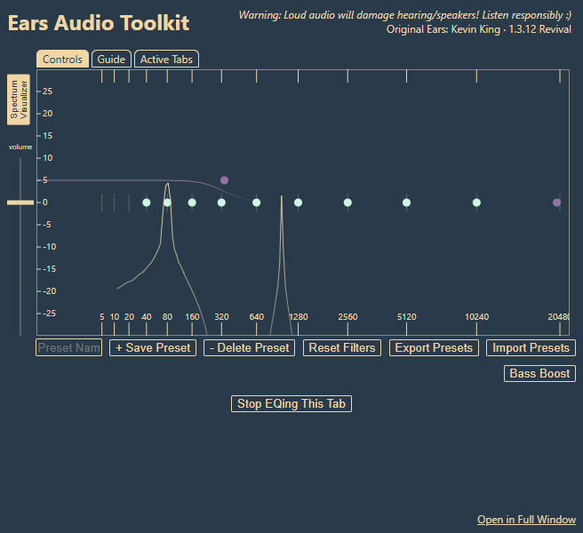

# Ears Revival

Много лет пользовался Ears 1.3.12, пока Яндекс Браузер не перестал его включать. Другой эквалайзер не хотелось, привык к этим точкам, ползунку громкости и тому, как всё звучит.

Сохранился архив старой версии из него и вырос этот проект. Здесь Ears работает на Manifest V3, а привычный интерфейс остался на месте. Только цвета чуть поменялись.

Сейчас версия **1.3.14**. Проверялась в Яндекс Браузере и Chrome на Windows 10.



## Как поставить

1. Скачай проект: **Code → Download ZIP**.
2. Распакуй в папку, которую потом не будешь удалять или переносить.
3. Открой `browser://extensions` в Яндексе или `chrome://extensions` в Chrome.
4. Включи **Режим разработчика** и нажми **Загрузить распакованное расширение**.
5. Выбери папку **`extension`** внутри проекта. Именно её, не весь распакованный архив.

Теперь открой вкладку с музыкой и нажми значок Ears. Вкладка подключится к эквалайзеру.

При обновлении замени файлы в той же папке и перезагрузи расширение на странице расширений. Захват звука при этом остановится — после обновления нажми значок Ears на нужных вкладках снова. Пресеты на всякий случай можно заранее выгрузить через **Export Presets**.

## Если забыл, как им пользоваться

- Тянешь точку влево или вправо — выбираешь частоту. Вверх или вниз — усиливаешь или убираешь её.
- **Shift + перетаскивание** вверх/вниз меняет ширину фильтра, то есть Q.
- Двойной клик сбрасывает одну точку. **Reset Filters** сбрасывает всё, включая общую громкость.
- Слева **volume**, снизу **Bass Boost** и сохранённые пресеты. **Spectrum Visualizer** включает спектр.
- **Stop EQing This Tab** возвращает вкладке обычный звук. Перезагружать страницу не надо.

Чтобы добавить ещё одну вкладку, открой Ears на ней. Убирать вкладки по одной можно через **Active Tabs**. Эквалайзер у них общий — так было и в оригинале.

Popup можно закрыть: музыка продолжит обрабатываться. После перезапуска браузера настройки останутся, а вкладки нужно подключить заново. Старые JSON-пресеты Ears тоже можно импортировать. Общая громкость в пресет не входит.

**Open in Full Window** просто открывает ту же панель в отдельной вкладке. График остаётся размером 600×300, поэтому на большом мониторе вокруг будет пустое место. Это исходная компоновка Ears.

## Пара моментов

В магазин расширений проект пока не выложен. Яндекс иногда отключает локальные расширения после перезапуска — тогда его нужно включить снова.

На служебных страницах браузера и в некоторых защищённых плеерах захват не работает. Если что-то пошло не так, попробуй **Stop → EQ**. А с усилением лучше аккуратнее лимитера здесь нет, сильно выкрученные фильтры могут давать перегруз.

Звук обрабатывается прямо в браузере. Аналитики, рекламы и отправки аудио на сервер нет. Настройки хранятся локально. Подробнее — в [политике конфиденциальности](PRIVACY_POLICY.md).

## Нашёл баг или хочешь что-то предложить?

Пиши в [Issues](https://github.com/Kagamisu/ears-revival/issues), на [abusovislam8@gmail.com](mailto:abusovislam8@gmail.com) или в Telegram [@kagamisu](https://t.me/kagamisu).

Для бага пригодятся версия браузера, версия расширения и несколько шагов, после которых он появляется.

<details>
<summary>Если хочешь покопаться в исходниках</summary>

Для обычной установки Node.js и Python не нужны. Папка `extension` уже готова к загрузке.

Для разработки нужен Node.js 20+. Быстрые проверки запускаются так:

```sh
npm test
```

Для браузерных тестов понадобятся зависимости:

```sh
npm ci
npm run test:chrome
# или npm run test:yandex
```

Скрипты используют отдельные профили и перед тестовыми тонами переключают Web Audio на беззвучный выход. Свой путь браузера можно передать через `EARS_BROWSER`.

ZIP собирается командой `python tools/build.py` — нужен Python 3.10+. Архивы появятся рядом с папкой проекта.

[Что внутри](docs/ARCHITECTURE.md) · [Что проверялось](docs/TEST_REPORT.md) · [Проверки на GitHub](https://github.com/Kagamisu/ears-revival/actions/workflows/checks.yml) · [Изменения](CHANGELOG.md).

</details>

Оригинальную Ears сделал **Kevin King**. Это неофициальное продолжение, не его новый релиз. Происхождение кода и условия для разных частей проекта собраны в [LICENSE.md](LICENSE.md).
