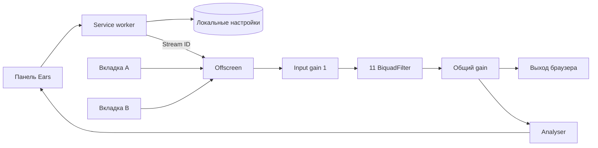

# Как это работает

У старой Ears звук жил в постоянной фоновой странице. В Manifest V3 её больше нет, поэтому аудио пришлось вынести в offscreen-документ. Он остаётся открытым после закрытия popup.

## Где что лежит

`service-worker.js` получает команды панели, проверяет отправителя, выдаёт токен захвата и сохраняет параметры. Команды выполняются по очереди. Worker может остановиться, поэтому живые потоки в нём не хранятся.

`audio-engine.js` держит AudioContext, фильтры и tracks. `offscreen.js` принимает команды для него. У offscreen указан reason `USER_MEDIA`, потому что он вызывает getUserMedia. Причина AUDIO_PLAYBACK здесь не подходит по поведению: документ мог бы закрыться после тишины, хотя музыка просто стоит на паузе. Схема описана в [примере Chrome](https://developer.chrome.com/docs/extensions/how-to/web-platform/screen-capture).

`settings.js` проверяет параметры и пресеты. `popup-bridge.js` связывает старые команды интерфейса с worker и запоминает, какой вкладкой управляет панель. Сам SVG-интерфейс — в `popup.js`.

## Что происходит при подключении

Нажатие значка даёт доступ к выбранной вкладке через activeTab. Worker создаёт offscreen и получает одноразовый stream ID. Offscreen сначала готовит аудиовыход, затем забирает поток и подключает его к общему входу. Если подключение не получилось, полученные tracks останавливаются и ресурсы освобождаются.

Все вкладки идут через одну цепочку. Порядок и параметры фильтров прежние, но нейтральные фильтры теперь тоже остаются подключёнными: при gain=0 они прозрачны, а соединения не приходится менять при каждом движении точки. Параметры сглаживаются с постоянной времени 8 мс. Компрессора и скрытого лимитера нет.

Спектр снимается после общего gain: FFT 8192, smoothing 0.5. Если запросов из панели больше нет, analyser отсоединяется примерно через 1,1 секунды. Закрытие панели и остановка worker на сам звук не влияют.

## Остановка и сбои

При отключении вкладки убирается её source и останавливаются все tracks. После последней вкладки закрываются AudioContext и offscreen. Закрытие вкладки и событие track.ended приводят к такой же очистке.

При повторном открытии панель получает сохранённые параметры и список живых потоков; контекст при необходимости получает попытку resume. После полного перезапуска браузера потоки создаются заново только по действию пользователя. Токены захвата и URL для скрытого переподключения не сохраняются.

Если перестал работать вывод или сменилось устройство, может понадобиться Stop → EQ либо перезагрузка расширения. Эти ситуации с физическими устройствами отдельно не проверялись. Задержка и короткий разрыв при переключении самого браузерного аудиотракта всё ещё возможны.
