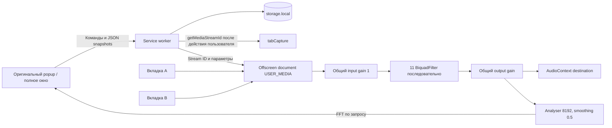

# Архитектура аудио

`settings.js` валидирует и преобразует параметры. `service-worker.js` проверяет источник сообщений, последовательно исполняет команды, создаёт offscreen-документ, получает токен захвата и сохраняет изменения до подтверждения popup. Глобальные переменные worker не служат источником истины: сохранённые параметры находятся в local storage, живые sessions — в offscreen.

`offscreen.js` принимает команды только от собственного worker. `audio-engine.js` владеет AudioContext, nodes и всеми MediaStreamTrack. `popup-bridge.js` переводит исходные сообщения Ears в запросы с ответом и сохраняет привязку к вкладке. `popup.js` содержит адаптированный оригинальный SVG-интерфейс. Нативные объекты аудио между контекстами не передаются.

Выбран reason `USER_MEDIA`, соответствующий getUserMedia. Offscreen существует только при захвате или его запуске. Не используется AUDIO_PLAYBACK с автоматическим закрытием после тишины: пауза музыки не должна останавливать захват. Это допустимое применение offscreen для таб-аудио в [официальном примере Chrome](https://developer.chrome.com/docs/extensions/how-to/web-platform/screen-capture).

## Жизненный цикл

1. Открытие Ears на вкладке предоставляет activeTab. Worker создаёт offscreen и получает одноразовый stream ID непосредственно перед использованием.
2. Offscreen сначала создаёт граф и возобновляет выход, затем получает stream и подключает его к input. Ошибки останавливают полученные tracks, отключают source и при необходимости закрывают контекст.
3. Все вкладки суммируются в общий input. Порядок фильтров и параметры исходные. Нулевые фильтры остаются в фиксированной цепи: это избавляет от переключения соединений при пересечении gain=0. Их нативная АЧХ прозрачна.
4. Параметры меняются через AudioParam с постоянной времени 8 мс. Никаких дополнительных эффектов/лимитера не добавлено; до окончательного значения остаётся короткий переход.
5. Закрытие интерфейса удаляет его document и polling, но не аудиограф. Analyser без запросов отсоединяется через ~1,1 с. Сервисный worker может остановиться независимо.
6. Остановка одной вкладки удаляет запись и source, останавливает все её tracks. Последняя вкладка закрывает AudioContext и offscreen. Закрытие исходной вкладки и внешний `track.ended` приводят к той же очистке.
7. Открытый UI периодически обновляет состояние вкладок без перерисовки фильтров во время drag. При открытии выполняются синхронизация параметров и попытка resume живого контекста.
8. Перезапуск браузера уничтожает streams и offscreen. Сохранённые фильтры и пресеты остаются. Тихого повторного захвата, фонового восстановления по URL или истории вкладок нет.

## Восстановление и ограничения

Capture ID не сохраняется. При исчезновении offscreen или остановке потока вкладка снова получает обычный браузерный звук; для нового захвата пользователь открывает Ears. Полностью автоматический перезахват после сбоя не выполняется: это могло бы потребовать нового пользовательского разрешения и привести к неожиданному захвату.

Отказ аудиодрайвера/изменение устройства вывода может потребовать Stop → EQ или перезагрузку расширения. Часовые прогоны и смена физического устройства отдельно не проверялись. Нулевая задержка/абсолютное отсутствие переходного разрыва не обещаются: таб-захват сам перенаправляет аудио в браузере. Очистка собственного графа и обработка неудачного подключения реализованы.
